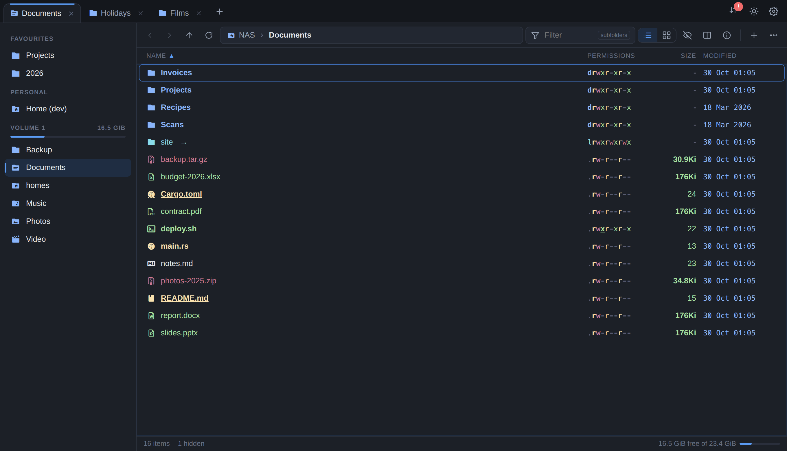
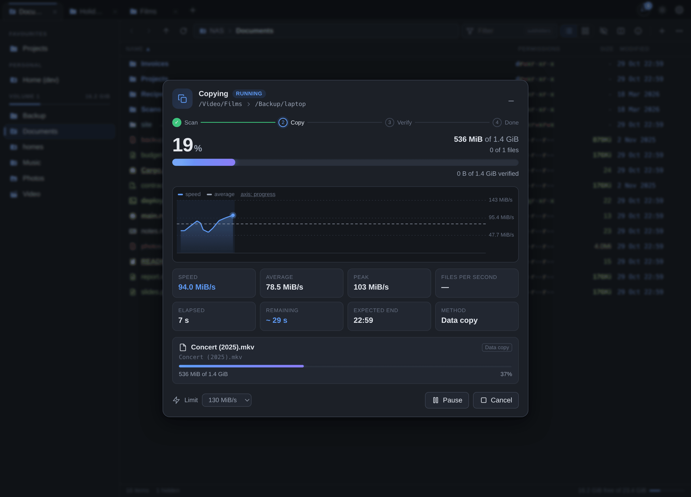
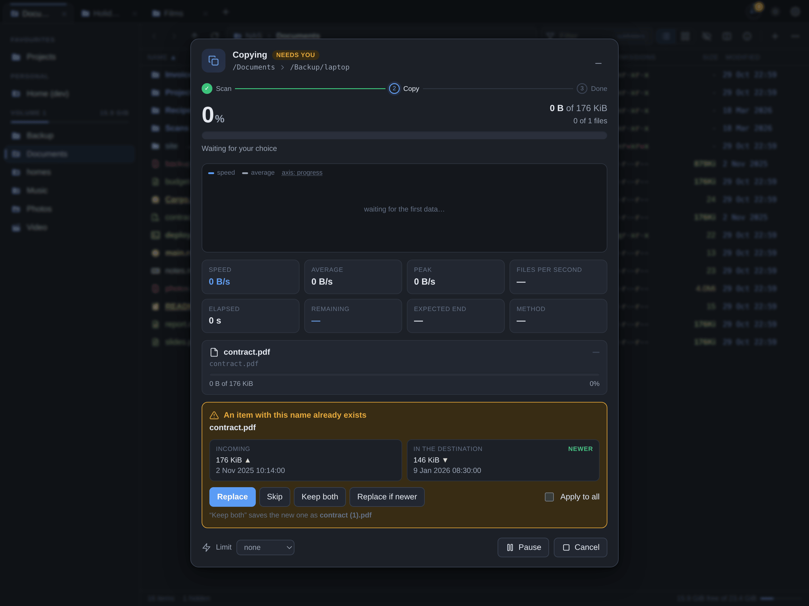
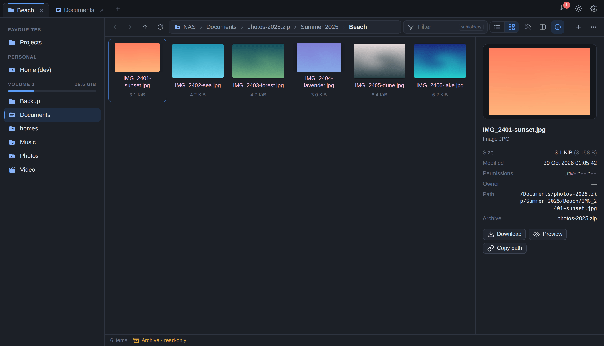
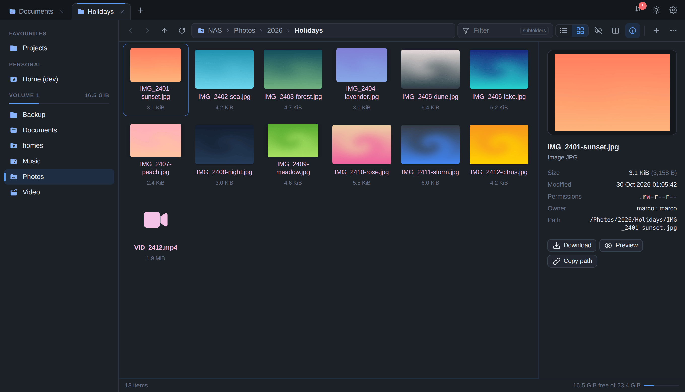
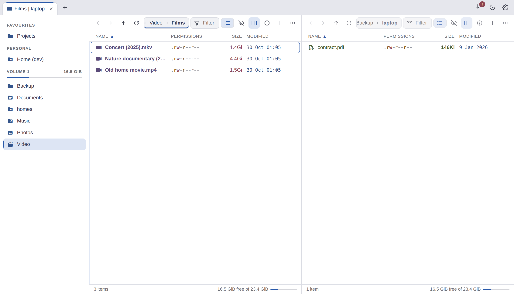

# SynoFile

A modern file manager for the shared folders of a Synology NAS, as a DSM 7
package: dark or light, keyboard first, with tabs, a dual pane, the icons and
colours of [eza](https://github.com/eza-community/eza), archives you can walk
into, and a transfer dialog that shows what a copy is really doing.

It opens from DSM's main menu, uses the DSM login and is reserved to the
`administrators` group. Every operation runs **as the DSM user who asked**,
so the kernel applies that user's permissions and Synology ACLs, as SMB does.
Nine languages, following DSM.



## Highlights

- **Transfers you can watch.** One dialog for copies, moves, deletions,
  archives and uploads: a speed chart, current, average and peak speed, time
  left, the file in flight, conflicts side by side, pause, cancel and a speed
  limit that changes while it runs. Transfers run on the NAS and go on when
  the browser closes; while they run, or wait paused, an icon in DSM's
  taskbar shows their progress, a click away from their dialog.
- **Copies that cannot half-fail.** Data goes to a hidden `.name.synofile-part`
  renamed into place when complete; inside one btrfs volume a copy is an
  instant **reflink**; an optional xxHash3 check reads every file back. A
  destination you cannot write to fails at once with the reason; cancelling
  leaves nothing behind. If the package restarts mid-transfer, the partial
  files are cleaned up and the job comes back as interrupted, with **Retry**.
- **Archives open like folders.** zip, 7z, rar, tar and tar.gz/bz2/xz/zst, iso:
  walk in, preview or download a file, copy items out (only those are
  extracted). Space shows the contents at a glance. Compress to `.zip`;
  extract password-protected archives too.
- **DSM's own Recycle Bin.** Deleting hands items to DSM's `synorecycle`, so
  they land in `#recycle` exactly as File Station puts them there.
- **eza in the browser.** The list looks like `eza -l`: icons and colours for
  every file type and well-known name, coloured permissions, sizes and dates.
  Each part can be switched off.
- **Find things fast.** A ranked fuzzy filter of the folder as you type (`/`),
  and a search through subfolders by words or a glob (`*.mkv`, Ctrl+F).
- **Quick look** (Space): images with zoom and pan, **HEIC/HEIF photos**
  (decoded in the browser, the NAS does no work), video, audio, PDF, text.
- **Tabs and dual pane.** Ctrl+T, Ctrl+W, Ctrl+Shift+T to reopen; F3 splits,
  F5 and F6 copy and move to the other pane. Drag and drop moves within a
  shared folder and copies across them; Ctrl copies, Shift moves, Alt asks.
- **Uploads** of files and whole folders that resume after a network error;
  downloads of folders and selections as a `.zip` stream.
- **Made to fit.** The volumes show their Storage Manager names and can be
  reordered; favourites, hidden files (Ctrl+H), view and sort remembered for
  each folder, where it opens, where new tabs open, single or double click,
  Vim keys.

<p align="center">
  
  
</p>
<p align="center">
  
  
</p>
<p align="center">
  
</p>

*A copy with its speed chart; a conflict; inside a zip archive; the grid with
the info panel; the dual pane in the light theme.*

*Made-up data: `tools/screenshots.sh` takes the screenshots again.*

## Install

Take `synofile-<version>.spk` from the
[releases](https://github.com/rylos/synofile/releases), or build it with
`./build.sh` (Rust with the `x86_64-unknown-linux-musl` target). Then, on the
NAS (x86_64, DSM 7):

```sh
scp -O synofile-*.spk admin@nas:
ssh admin@nas 'sudo /usr/syno/bin/synopkg install synofile-*.spk'
ssh admin@nas 'sudo /var/packages/synofile/target/bin/synofile setup'
ssh admin@nas 'sudo /usr/syno/bin/synopkg restart synofile'
```

Package Center's *Manual install* works too. **`setup` has to run again after
every install or upgrade**; the interface says so, with the command, when the
permissions are missing. An upgrade restarts the package: running transfers
come back as interrupted. `curl -s http://127.0.0.1:5000/webman/3rdparty/synofile/api.cgi/health`
on the NAS tells whether setup ran and the transfer service is up.

## How it works

- DSM's web server runs `ui/api.cgi` per request as the package's
  unprivileged user. The static Rust binary asks DSM's `authenticate.cgi` who
  is logged in, refuses anyone outside `administrators`, then **becomes that
  user** (groups, gid, uid, no capability left, `no_new_privs`) before it
  touches a file.
- That takes `CAP_SETUID` and `CAP_SETGID`. DSM 7 refuses `capabilities` in
  third-party packages (error 319), so `synofile setup`, as root, writes the
  file capability and gives the binaries to root.
- `synofile daemon` keeps the transfers, reached over a Unix socket only the
  package can open. Each job runs in `synofile-worker`, already the user,
  reporting progress over a pipe. Unfinished jobs are journalled on disk.
- Archives are written by SynoFile's own streaming zip writer (deflate,
  zip64, UTF-8 names); listing and extraction use the NAS's 7-Zip, GNU tar
  and `unrar`, into a hidden folder first, then moved into place under the
  conflict rule. 7-Zip gets passwords on stdin, never on the command line.
- Every URL carries the build, so a page left open across an upgrade reloads
  itself.

## Languages

English, Italian, German, French, Spanish, Dutch, Portuguese (Portugal and
Brazil) and Polish, following DSM's language, English for any other. Terms
follow DSM's own translations (`docs/glossary.md`, shared with
[btrbk-nas](https://github.com/rylos/btrbk-nas)). The translations were not
reviewed by native speakers: corrections are welcome.

Strings are written in Italian in the code (`t("Nuova cartella")`,
`t!("italiano", "English")`); tables live in `ui/js/lang/<code>.js` and
`src/lang/<code>.json`.

```sh
tools/i18n-check.py --new sv   # a new language, from the English
tools/i18n-check.py            # what is missing, unused or with wrong placeholders
```

## Development

```sh
cargo build && tools/devserver.py --root /some/folder   # its subfolders play the shares
tools/screenshots.sh                                    # the README's screenshots, on made-up data
tools/gen-eza.py path/to/eza                            # regenerate eza's icons and colours
```

Debug builds honour `SYNOFILE_DEV_USER` instead of the DSM login.

## Credits

The look and the keyboard come from [flea](https://github.com/thisisgm/flea).
Icons and file-type tables come from eza (MIT / EUPL-1.2), the icon font is a
subset of the [Nerd Fonts](https://www.nerdfonts.com) symbols (MIT / OFL),
and the light theme is Tokyo Night Light.

## License

MIT. `ui/vendor/libheif` is [libheif-js](https://github.com/catdad-experiments/libheif-js)
(libheif and libde265 compiled to WebAssembly), LGPL-3.0, shipped unmodified.
